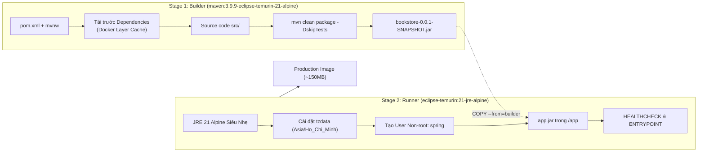
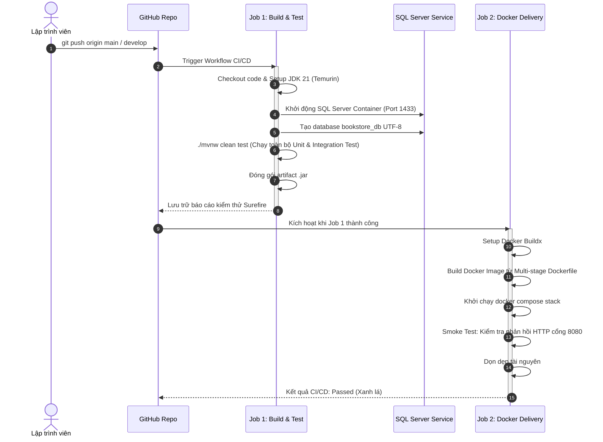

# 🚀 TÀI LIỆU DEVOPS & CI/CD PIPELINE - BOOKSTORE CHAIN

> **Dự án**: Website Quản Lý Chuỗi Cửa Hàng Bán Sách Cũ Trực Tuyến  
> **Ngăn xếp công nghệ**: Spring Boot 3, Java 21, Microsoft SQL Server 2022, Docker, Docker Compose, GitHub Actions.

---

## 1. BẢNG SO SÁNH NÂNG CẤP KIẾN TRÚC

| Tiêu chí | Chạy thủ công trên Local (Cũ) | Chuẩn DevOps Production-Ready (Mới) | Lợi ích thuyết phục Hội đồng chấm điểm |
| :--- | :--- | :--- | :--- |
| **Môi trường chạy** | Cài JDK 21, Maven, SQL Server SSMS thủ công trên Windows | Chuẩn hóa hoàn toàn qua **Docker Containers** | Chạy nhất quán trên mọi máy (Windows, Mac, Linux), không gặp lỗi "chạy được trên máy em nhưng máy thầy bị lỗi". |
| **Đóng gói ứng dụng** | Build file `.jar` nặng trên local máy | **Docker Multi-Stage Build** (Stage 1: Build -> Stage 2: Runtime JRE 21 Alpine) | Tối ưu kích thước image siêu nhẹ (~150MB), bảo mật với Non-root user `spring`. |
| **Cơ sở dữ liệu** | Tạo database thủ công qua SQL Server Management Studio | **SQL Server 2022 Container + Auto Init Script** tự động tạo `bookstore_db` | Tự động hóa 100%, có healthcheck đảm bảo database sẵn sàng trước khi app kết nối. |
| **Tự động hóa kiểm thử & tích hợp** | Chạy bằng tay hoặc không có CI/CD | **GitHub Actions Pipeline** chạy tự động khi `git push` hoặc `pull_request` | Tự động biên dịch, chạy Unit & Integration test với SQL Server container và Smoke test container. |
| **Khởi chạy hệ thống** | Chạy nhiều cửa sổ terminal, khởi động từng dịch vụ | **1 Câu lệnh duy nhất**: `docker compose up -d` | Bật toàn bộ ứng dụng và CSDL trong vòng 30 giây. |

---

## 2. KIẾN TRÚC MULTI-STAGE DOCKERFILE



---

## 3. CẤU TRÚC DOCKER COMPOSE

Hệ thống được điều phối qua file `docker-compose.yml` gồm 3 services:

1. **`sqlserver`**:
   * Image: `mcr.microsoft.com/mssql/server:2022-latest`
   * Cổng: `1433:1433`
   * Healthcheck tự động giám sát kết nối qua `sqlcmd`.
   * Dữ liệu được lưu trữ bền vững (Persistent Volume) tại `bookstore_mssql_data`.
2. **`init-db`**:
   * Chờ `sqlserver` đạt trạng thái `healthy`.
   * Tự động khởi tạo database `bookstore_db` với bảng mã `Latin1_General_100_CI_AS_SC_UTF8` để hỗ trợ tiếng Việt tuyệt đối.
3. **`app`**:
   * Build từ `Dockerfile` Multi-stage.
   * Lắng nghe cổng `8080:8080`.
   * Tự động kích hoạt Profile `docker` (`application-docker.properties`).

---

## 4. HƯỚNG DẪN KHỞI CHẠY VÀ VẬN HÀNH

### A. Khởi động toàn bộ hệ thống (1 câu lệnh)
Từ thư mục gốc của dự án, mở terminal và chạy:
```bash
docker compose up -d --build
```

### B. Kiểm tra trạng thái các container
```bash
docker compose ps
```

### C. Xem log thời gian thực của ứng dụng Spring Boot
```bash
docker compose logs -f app
```

### D. Truy cập ứng dụng
Sau khi khởi động thành công, mở trình duyệt:
* **Trang chủ**: `http://localhost:8080`
* **Đăng nhập**: `http://localhost:8080/login`
  * Admin: `admin@gmail.com` / `123456`
  * Manager: `manager@gmail.com` / `123456`
  * Vendor: `vendor@gmail.com` / `123456`
  * Shipper: `shipper@gmail.com` / `123456`
  * Customer: `user@gmail.com` / `123456`

### E. Dừng hệ thống
```bash
# Dừng các container nhưng giữ nguyên dữ liệu CSDL
docker compose down

# Dừng và xóa toàn bộ dữ liệu CSDL để làm mới từ đầu
docker compose down -v
```

---

## 5. QUY TRÌNH CI/CD TRÊN GITHUB ACTIONS (`.github/workflows/ci-cd.yml`)

Quy trình tự động hóa kích hoạt khi có code mới đẩy lên nhánh `main` hoặc `develop`:



---

## 6. ĐIỂM CỘNG ĐẶC BIỆT KHI BẢO VỆ ĐỒ ÁN TRƯỚC HỘI ĐỒNG

1. **Bảo mật Container (Security Best Practices)**:
   * Ứng dụng chạy dưới tài khoản không có quyền root (`USER spring:spring`), ngăn ngừa rủi ro leo thang đặc quyền container.
2. **Tối ưu hóa Docker Cache**:
   * Tách riêng bước copy `pom.xml` và `src/`, giúp các lần build sau chỉ mất vài giây nếu không thay đổi thư viện bên thứ 3.
3. **Quản lý bộ nhớ JVM thông minh**:
   * Sử dụng `-XX:+UseContainerSupport` và `-XX:MaxRAMPercentage=75.0` giúp JVM tự động điều chỉnh heap size theo giới hạn RAM của Docker container mà không bị lỗi OOM (Out Of Memory).
4. **Kiểm thử tự động trước khi đóng gói**:
   * Toàn bộ mã nguồn phải vượt qua bộ kiểm thử tự động với CSDL thật trước khi được phép đóng gói vào Docker image.
